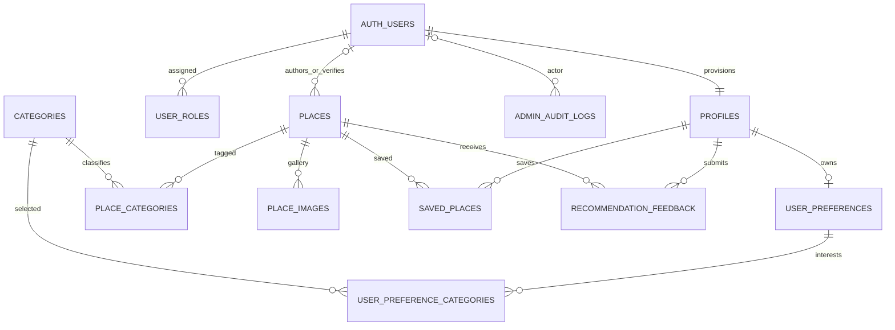

# Unseen Jo database foundation — Phase 02A

Status: **deployed and verified on project `dkhwwvoplhfjccvjegty` through dedicated MCP `supabase_unseen_jo`**. Remote PostgreSQL 17.11/PostGIS 3.3.7; 80 hosted SQL assertions and 17 HTTP checks passed. See the phase report for verification limits. Phase 02B now uses public reads through the shared repository; no schema or RLS change was required.

## Tables and relationships

All 11 application tables are in `public`, use RLS and have `created_at timestamptz`. Profiles, places, categories, image metadata, preferences and feedback also have a trigger-maintained `updated_at`. Independent content records use UUIDs; relationship tables use composite keys. PostgreSQL `gen_random_uuid()` avoids requiring another UUID extension.

| Table | Key and purpose | Relationships / constraints |
| --- | --- | --- |
| `profiles` | `id` UUID; private display name and avatar path | `auth.users.id`, cascade on account deletion; name 1–100 characters when present; avatar folder must match user ID |
| `user_roles` | `(user_id, role)`; trusted authorization assignments | Auth user plus optional assigning user; only `user`, `admin`, `partner`; ordinary users cannot insert/update/delete assignments |
| `places` | `id`, unique route-safe `slug`; name, description, city, address, publication, source/verification metadata, nullable price/duration/geography and visit notes | `draft`/`published`/`archived`; drafts by default; demo content cannot be published; verification requires a source URL and cannot apply to demo content; author/verifier FKs |
| `categories` | `id`, unique `slug` and name; active flag and ordering | Seven categories from the existing frontend vocabulary; no invented tourism facts |
| `place_categories` | `(place_id, category_id)` | Many-to-many; deleting a place removes its links; referenced categories cannot be removed accidentally |
| `place_images` | `id`, place, unique storage path, alt text, display order, cover flag, optional attribution/source | Place-folder path constraint; one cover per place via partial unique index; deleting metadata does not delete Storage bytes |
| `user_preferences` | `user_id`; nullable city, available minutes, minimum/maximum JOD budget, group and transport | One per profile; no inferred values copied from demo state; validated positive minutes, nonnegative ordered budgets and supported group/transport vocabulary |
| `user_preference_categories` | `(user_id, category_id)` | Normalized interest selection with actual category FKs, rather than an array of unchecked IDs; one additional table beyond the ten requested core entities |
| `saved_places` | `(user_id, place_id)` | No duplicate saves; users may save only published places and read/remove their own saves |
| `recommendation_feedback` | `id`; unique `(user_id, place_id)` | Owner-only interested/not-interested/visited feedback and optional bounded comment; no scoring or recommendation algorithm |
| `admin_audit_logs` | `id`; actor, operation, table, entity identifiers, changed column names | Trusted triggers append; clients, including admins, cannot directly insert/update/delete; admins can read; private field values are not logged |

Unknown values remain `NULL`, including price bounds, duration bounds, coordinates, verification and visit notes. No road distances, driving times or opening hours are invented. JOD is explicit in column names. Prices and budgets reject negatives and numeric NaN; durations must be positive and ranges ordered. Latitude is −90…90, longitude −180…180; coordinates must be supplied together. Images require meaningful alt text and reject paths with `..`.

`auth.users` and Storage tables are Supabase-owned platform objects, not application-created tables. No partner portal or partner-specific business records are implemented. The reserved `partner` role has ordinary-user privileges only; future capabilities require explicit policies and migrations.

## RLS and authorization matrix

Grants and policies work together. Access is denied unless both permit the operation. All public application tables are initially closed in the foundation migration; the next migration adds only the required grants. No globally permissive browser policy is installed.

| Resource | Anonymous | Ordinary authenticated user / future partner | Admin |
| --- | --- | --- | --- |
| Places | Read published | Read published | Read all; create/update/delete |
| Categories | Read active | Read active | Read all; create/update/delete |
| Place category/image metadata | Read associated visible content | Read associated visible content | Read and manage all content links/images |
| Profiles | None | Read own; update **only** display name/avatar | Same own-profile access; no blanket private-profile access |
| Role assignments | None | Read own only; no writes | Read/manage assignments |
| Preferences and interests | None | Own select/insert/update where supported/delete | Own only; no private-record bypass |
| Saved places | None | Own select/insert/delete; published target required on insert | Own only |
| Recommendation feedback | None | Own select/insert/update/delete; published target required on insert | Own only |
| Audit logs | None | None | Read only; trusted triggers write |
| Place image Storage objects | Read only when linked to a published place | Same read | Read/manage place-image objects; upload/update requires an existing place UUID folder |
| Profile avatar Storage objects | None | Own UUID folder only, including SELECT/INSERT/UPDATE/DELETE | Own folder only |

Private rows remain private even from another admin. Existing saved/feedback relationship IDs may remain visible to their owner after a place is unpublished; the place record and photo become inaccessible to ordinary users. Removal still works. A future frontend integration must handle this unavailable-content state.

`unseen_private.is_admin()` checks the caller's `auth.uid()` against the database's role assignments. It is a stable `SECURITY DEFINER` lookup to avoid recursive RLS. It never trusts editable JWT `user_metadata`. The non-exposed `unseen_private` schema has no PUBLIC usage; only authenticated users can execute this one helper. All four helpers pin an empty `search_path` and fully qualify application/platform objects. The Auth and audit `SECURITY DEFINER` functions are trigger-only, with direct API-role execution revoked. The timestamp helper is `SECURITY INVOKER`.

The Auth trigger creates a profile and ordinary `user` assignment for each **new** Auth user. It truncates optional metadata to a bounded display name and ignores metadata role claims. No existing accounts are backfilled blindly. There are no seeded users, passwords or administrators. Initial admin provisioning requires a verified real Auth user and a trusted database-owner operation after access is available; never a browser self-assignment. This has not been performed.

Audit triggers cover places, categories, place-category links, image metadata and role assignments. They record `auth.uid()` as actor, never a client-supplied audit actor. Deleting an Auth account nulls historical actor/author references while retaining content/audit records; private profile-dependent records cascade. Real Supabase Storage object ownership can prevent Auth-user deletion: an eventual account-deletion workflow must remove/reassign owned objects through the Storage API first. No account-deletion endpoint is implemented here. Database-owner/service infrastructure is inherently trusted; RLS does not constrain superusers or BYPASSRLS roles. No such credentials belong in browser configuration.

## Geographic foundation

PostGIS is installed into `extensions`. `places.latitude` and `longitude` are validated, nullable source coordinates. `location geography(Point,4326)` is generated from them, preventing disagreement between numeric coordinates and the spatial point. Longitude is passed first. A GiST index supports future `ST_DWithin`/distance discovery; published-date/city indexes and leading indexes for every application FK support normal/RLS lookups.

Local tests execute real `ST_X`, `ST_Y`, `ST_Distance` and `ST_DWithin` queries against synthetic points and check meter units. No proximity RPC, frontend map, device geolocation, route calculation or travel-time estimate is implemented. If remote PostGIS already exists in another schema, stop and adapt safely; **do not drop or relocate it**.

## Storage configuration

| Bucket | Access | Maximum object size | Allowed types | Object paths |
| --- | --- | --- | --- | --- |
| `place-images` | Private; RLS permits reads of published linked images | 5 MiB | JPEG, PNG, WebP, AVIF | `<place-uuid>/<filename>` |
| `profile-avatars` | Private; owner-only | 2 MiB | JPEG, PNG, WebP | `<auth-user-uuid>/<filename>` |

Bucket creation uses the documented SQL configuration path. Actual object upload, move and removal must go through the Storage API; never edit `storage.objects` metadata directly in the real project. Database fixtures touch only the disposable modeled Storage tables. MIME/size restrictions were inspected remotely; real Storage HTTP requests rejected SVG and oversized avatar uploads. Anonymous uploads were denied. Successful authenticated uploads/downloads and owner isolation through Storage HTTP remain untested. SVG uploads are not allowed. No Figma image was uploaded, replaced or removed; existing local assets remain the frontend source.

Published image access depends on a `place_images` link and a published parent. Admins can inspect/upload draft imagery. Profile avatars are not public and do not become admin-readable. Update policies check both the existing row and new bucket/path, preventing cross-user moves. Private buckets preserve publication/ownership checks; future signed URLs must use short lifetimes appropriate to possible unpublishing.

## Migration inventory

Originally created with the official CLI's `migration new` command; filenames aligned with MCP-assigned remote versions after deployment (SQL unchanged):

1. `20261015212231_phase02a_foundation.sql` — PostGIS, private schema, 11 tables, constraints/indexes, Auth/timestamp/audit helpers and triggers, immediate RLS/browser-access revocation.
2. `20261015212235_phase02a_access_and_storage.sql` — explicit column/table grants, ownership/admin policies, private buckets and Storage object policies.
3. `20261015212242_phase02a_categories.sql` — seven-category vocabulary, conflict-safe insertion only.

`seed.sql` repeats only the idempotent category vocabulary for local development. There is no destructive reset, DROP/TRUNCATE, application-table replacement or destination/user seed in these migrations. Object-name conflicts fail rather than overwrite an existing schema. Replaying the complete chain into **another fresh disposable database** reproduces columns, generated expressions and policies. Reapplying already tracked migrations to an existing deployment is not the workflow; migration history must prevent that.

## Validation scope and sources

`npm run test:database` covers grouped checks on PGlite PostgreSQL **18.6**, PostGIS **3.6.2**; final results are recorded in the phase report. This is actual SQL/PostGIS execution with test-only Auth/Storage contracts, not a full Supabase server. The PostGIS WASM package is experimental and development-only. Local CLI config defaults to PostgreSQL **17**, matching hosted PostgreSQL **17.11** with PostGIS **3.3.7**. Hosted RLS/grants/constraints/triggers/PostGIS were separately verified by 80 rollback-only assertions; 17 HTTP checks verified public Data API behavior, private access denial, Auth public settings and Storage rejection paths. Security advisors returned zero findings. Issued JWT/session flows, email delivery and successful authenticated Storage operations remain untested. See [setup](./SUPABASE_SETUP.md) and [Phase 02A status](./PHASE_02A_REPORT.md).

Current official references: [RLS](https://supabase.com/docs/guides/database/postgres/row-level-security), [Auth profile management](https://supabase.com/docs/guides/auth/managing-user-data), [PostGIS](https://supabase.com/docs/guides/database/extensions/postgis), [Storage access policies](https://supabase.com/docs/guides/storage/security/access-control), [bucket configuration](https://supabase.com/docs/guides/storage/buckets/creating-buckets), [Storage schema restrictions](https://supabase.com/docs/guides/storage/schema/design). Documentation/changelog and npm package releases were checked during this phase; no upcoming TLS change requires application changes for the current Node/browser setup.

## Phase 02B content and public reads

The original three schema migrations remain unchanged. Additive content DML imported six drafts with ten category relationships; seven categories remain active. No record is published, no image/object was created, and unknown/verification fields remain NULL. All 48 policy definitions match the pre-integration snapshot. Source/media review, live/demo modes, repository operations and tests are documented in [TOURISM_DATA.md](./TOURISM_DATA.md) and [PHASE_02B_REPORT.md](./PHASE_02B_REPORT.md).
